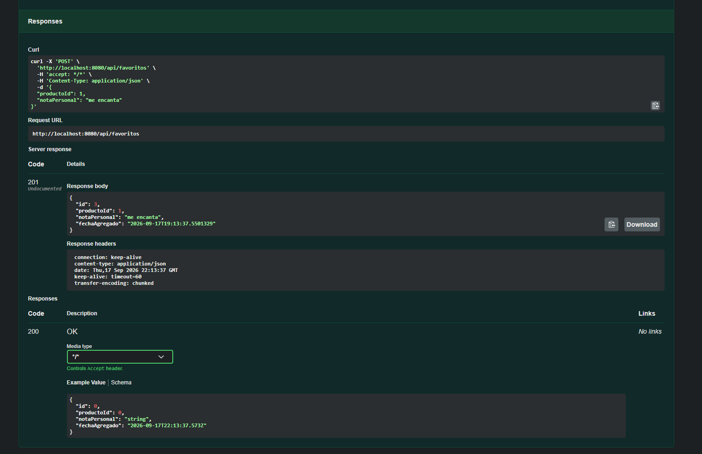
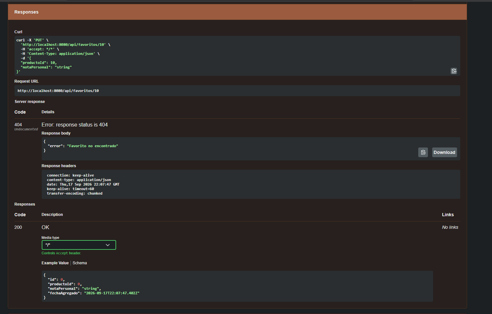

# TP1 · Spring Boot, API REST y arquitectura en capas

Punto de partida del práctico. Está armada la **configuración e
infraestructura transversal** que van a necesitar sin importar cómo
resuelvan cada consigna; lo que falta —el diseño y la lógica propia de cada
recurso— se va a ir sumando a esta rama a medida que avance la cursada.

## Cómo levantar el proyecto

Requiere Java 25. Usar siempre el wrapper, nunca un `mvn` instalado aparte:

```
# Windows
.\mvnw.cmd spring-boot:run

# macOS/Linux
./mvnw spring-boot:run
```

Cuando el log muestre `Started DemoApplication`, la app queda escuchando en
`http://localhost:8080`.

Para compilar y correr los tests: `./mvnw test` (o `.\mvnw.cmd test`).

## Endpoints disponibles hoy

| Método | Path | Qué hace |
|---|---|---|
| GET | `/health` | Chequeo de salud básico |
| GET | `/ping` | Devuelve `pong`, sin JSON — otro chequeo trivial |
| GET | `/api/productos` | Lista el catálogo completo de productos consumiendo DummyJSON |
| GET | `/api/productos/{id}` | Obtiene un producto específico consumiendo DummyJSON |
| GET | `/api/favoritos` | Lista todos los favoritos guardados en memoria |
| POST | `/api/favoritos` | Crea un nuevo favorito |
| GET | `/api/favoritos/{id}` | Obtiene un favorito por su ID |
| PUT | `/api/favoritos/{id}` | Actualiza la nota o producto de un favorito |
| DELETE| `/api/favoritos/{id}` | Elimina un favorito |

Para acceder a la documentación interactiva de la API con Swagger UI, ingresar a:
`http://localhost:8080/swagger-ui/index.html`

```
curl http://localhost:8080/health
curl http://localhost:8080/ping
```

## Qué ya está armado

- **`config/RestClientConfig`**: bean de `RestClient` apuntado a la
  `base-url` de DummyJSON (`app.dummyjson.base-url` en
  `application.properties`). Listo para inyectar.
- **`config/OpenApiConfig`**: metadata general de Swagger UI.
- **`client/dummyjson/DummyJsonProducto` y `DummyJsonProductosResponse`**:
  la forma exacta del JSON que devuelve `https://dummyjson.com/products` —
  para no tener que adivinar los nombres de campo del proveedor externo.
- **`exception/GlobalExceptionHandler`** (+ `RecursoNoEncontradoException` y
  `ServicioExternoException`): manejo uniforme de errores para toda la API
  (`ProblemDetail`). Ya contempla 404 y errores de un servicio externo —
  se reusa tal cual para cualquier recurso nuevo que se agregue.

## Qué se agregó en este TP

- Un cliente propio implementado en `ProductoService` que usa el
  `RestClient` configurado para llamar a `/products` y `/products/{id}`.
- Un DTO propio (`ProductoDTO`) para exponer los productos con nuestra estructura.
- Todo el recurso de favoritos: entidad (`Favorito`), repository en memoria (`FavoritoRepositoryImpl`), DTOs de entrada y salida, service (`FavoritoService`) y controller CRUD (`FavoritoController`).
- Validaciones con `@Valid` y manejo de excepciones (404 y 400).
- Documentación de controllers con `@Operation` para Swagger UI.

## Dependencias

- `spring-boot-starter-webmvc` — Spring MVC + Tomcat embebido.
- `spring-boot-starter-validation` — Bean Validation (`@NotNull`, `@NotBlank`, ...).
- `springdoc-openapi-starter-webmvc-ui` — Swagger UI / OpenAPI.


